# PetBoutique · Plataforma para hotel de mascotas

Aplicación web para un hotel y boutique de mascotas: los clientes registran a sus mascotas, reservan estancias y
servicios (peluquería, veterinario, adiestramiento…) y compran en la tienda online; el equipo gestiona reservas,
pedidos, productos y clientes desde un panel de administración.

> **Proyecto final del CFGS de Desarrollo de Aplicaciones Web** (Universidad Europea, 2026), desarrollado en equipo
> con **Ana Bardaguer** ([@abardker](https://github.com/abardker)) y **Carles Magraner**
> ([@carlesmagraner](https://github.com/carlesmagraner)). Este repositorio es una **versión de demostración**
> publicada con su permiso: sin historial, sin credenciales y con datos ficticios.

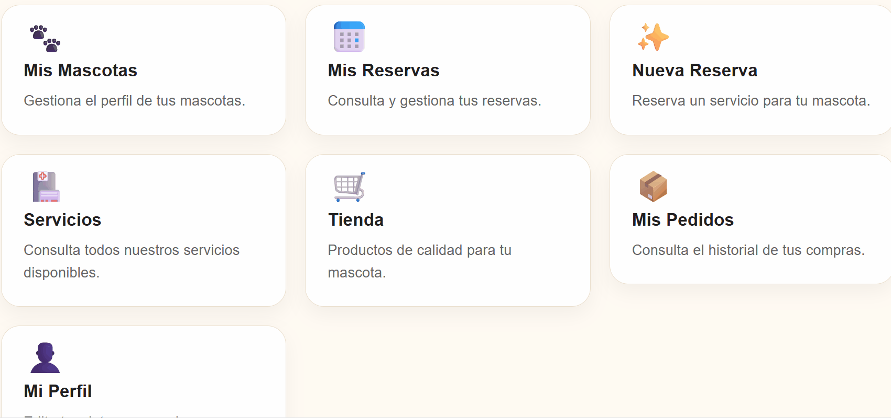

---

## Mi aportación

**Desarrollé el backend** de la aplicación con Python y FastAPI:

- **Diseño inicial de la base de datos** y su modelado con **SQLAlchemy**: usuarios, mascotas, servicios, reservas,
  citas, productos y pedidos, con sus relaciones.
- **Validación de datos con Pydantic**: schemas de entrada y salida para cada recurso.
- **API REST**: 33 endpoints de usuarios, mascotas, servicios, reservas, citas, productos y pedidos (CRUD,
  búsqueda y cambios de estado), además del registro y el login.
- **Autenticación y seguridad**: login con **JWT** (flujo OAuth2 password), contraseñas cifradas con **bcrypt** y
  dependencias de FastAPI para proteger los endpoints y obtener el usuario actual.
- **Lógica de negocio** de reservas, pedidos y servicios.
- **Carga de datos de ejemplo** (`seed.py`) para desarrollo y demostración.

El resto del equipo:

- **Ana Bardaguer**: frontend en React (tienda, zona de cliente y panel de administración), **chatbot con IA
  (Groq)**, migración de la base de datos a **Supabase (PostgreSQL)** y **despliegue** en Vercel y Render.
- **Carles Magraner**: estructura base del frontend y **diseño visual**: página de inicio, interfaz de reservas con
  servicios adicionales, aviso de cookies y estilos.

| Panel de Swagger | Login con JWT | Respuesta autenticada |
|---|---|---|
| 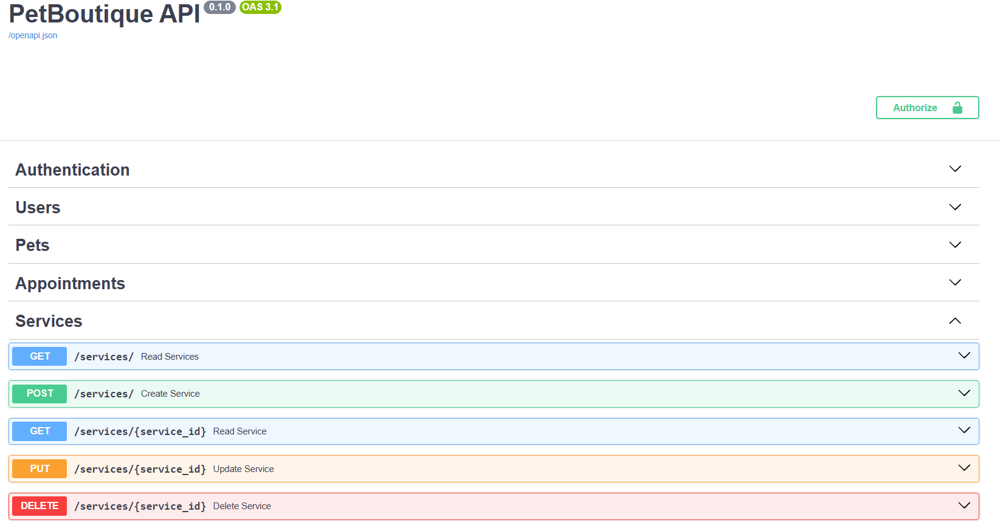 | 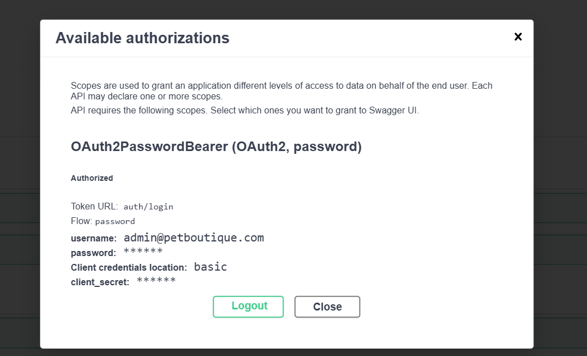 | 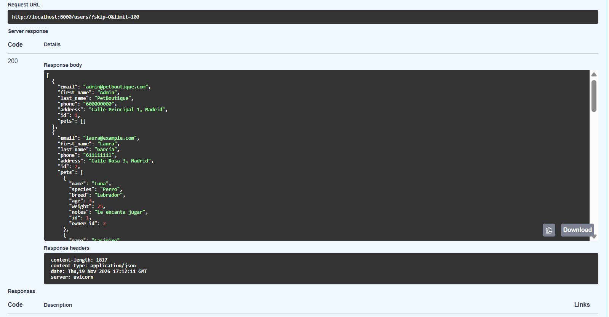 |

## Funcionalidades

**Zona de cliente**
- Registro e inicio de sesión.
- Gestión de sus mascotas.
- Reservas de estancias y servicios con extras, cálculo del total y pago de un depósito.
- Tienda online con carrito y seguimiento de pedidos.
- Asistente virtual (chatbot con IA).

**Panel de administración**
- Resumen del negocio: clientes, mascotas, servicios, citas y pedidos pendientes.
- Gestión de reservas con filtros por estado (confirmar, cancelar, eliminar).
- Gestión de pedidos, productos y clientes.

## Capturas

| Inicio | Servicios |
|---|---|
| 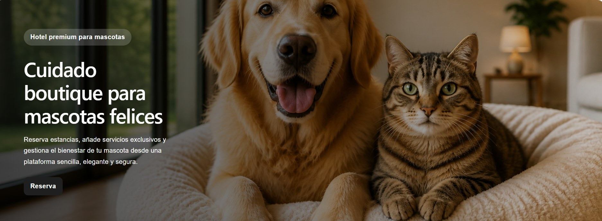 | 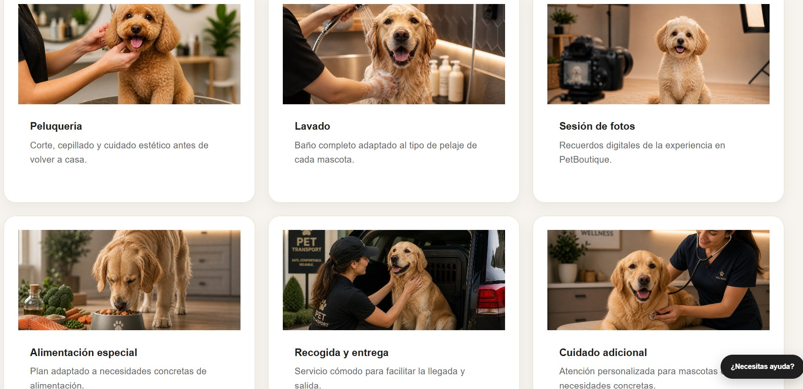 |

| Tienda | Productos |
|---|---|
| 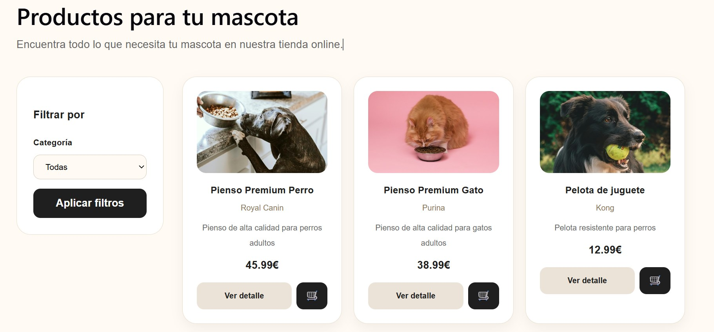 | 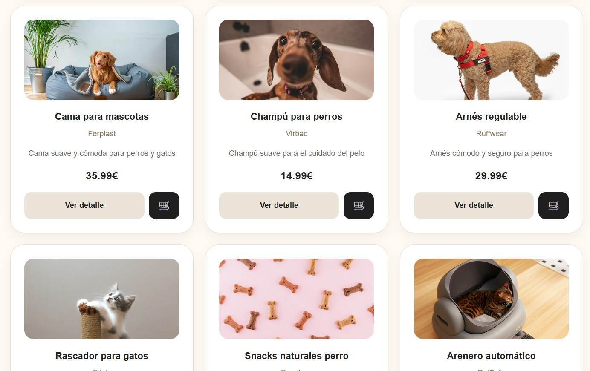 |

| Nueva reserva | Mis mascotas |
|---|---|
| 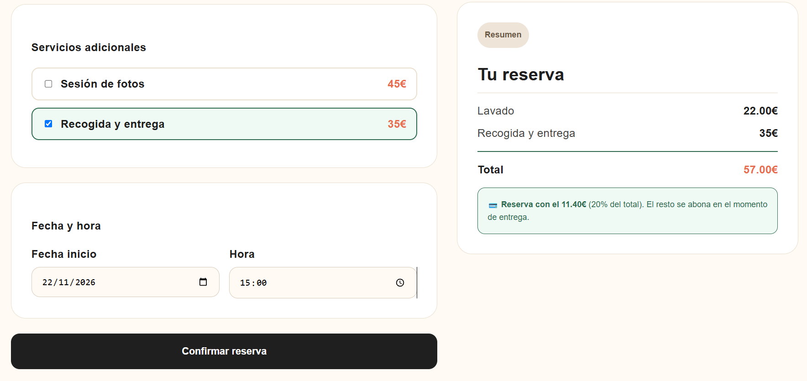 | 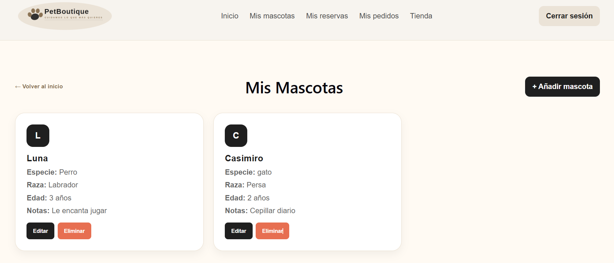 |

| Panel de control | Gestión de reservas |
|---|---|
| 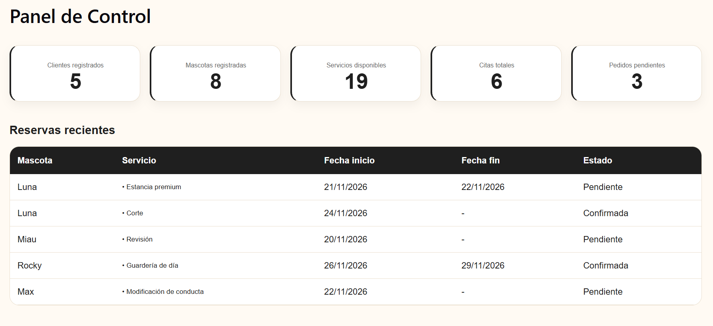 | 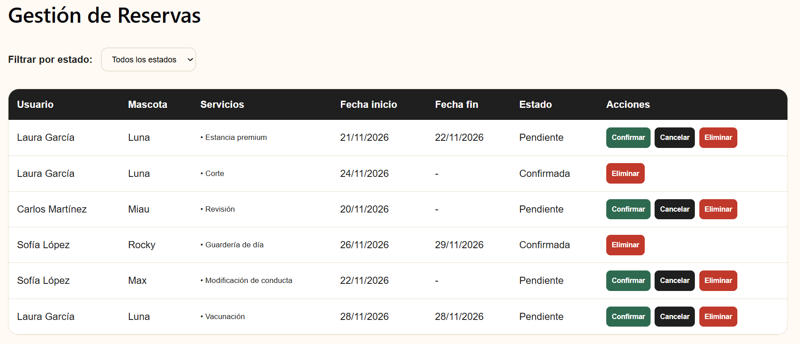 |

## Tecnologías

| Capa | Tecnología |
|---|---|
| Backend | Python · FastAPI · SQLAlchemy · Pydantic · JWT (PyJWT / python-jose) · passlib + bcrypt |
| Base de datos | SQLite en esta demo · MySQL en el desarrollo inicial · PostgreSQL (Supabase) en producción |
| Frontend | React 19 · Vite · React Router · SweetAlert2 |
| IA | Chatbot con la API de Groq (modelo Llama 3.3) |

## API

La documentación interactiva (Swagger) está en `http://localhost:8000/docs` al arrancar el backend.

| Recurso | Ruta | Operaciones |
|---|---|---|
| Autenticación | `/auth` | Registro y login (devuelve un JWT) |
| Usuarios | `/users` | CRUD |
| Mascotas | `/pets` | CRUD, mascotas del usuario autenticado (`/pets/me`) y búsqueda |
| Servicios | `/services` | CRUD |
| Reservas | `/bookings` | Crear, listar, eliminar y cambiar estado |
| Citas | `/appointments` | Crear, listar y citas de un usuario |
| Productos | `/products` | CRUD |
| Pedidos | `/orders` | Crear, listar y cambiar estado |
| Chatbot | `/chat` | Conversación con el asistente |

```
├── main.py            punto de entrada: crea la app, CORS y carga los datos de ejemplo
├── seed.py            datos de demostración
├── app/
│   ├── models.py      tablas (SQLAlchemy)
│   ├── schemas.py     validación (Pydantic)
│   ├── auth.py        registro y login
│   ├── deps.py        dependencias: usuario autenticado
│   ├── core/          seguridad: JWT y contraseñas
│   ├── crud/          acceso a datos
│   ├── api/           endpoints por recurso
│   └── db/            conexión a la base de datos
└── frontend/          aplicación React
```

## Probarlo en local

**Requisitos:** Python 3.12+ y Node.js 20+. No hace falta instalar ninguna base de datos: la demo usa SQLite y
crea las tablas y los datos de ejemplo al arrancar.

```bash
# 1. Backend → http://localhost:8000/docs
cp .env.example .env            # Windows: Copy-Item .env.example .env
python -m venv venv
venv\Scripts\activate           # Linux/Mac: source venv/bin/activate
pip install -r requirements.txt
python -m uvicorn main:app --reload --port 8000

# 2. Frontend → http://localhost:5173  (en otra terminal)
cd frontend
npm install
npm run dev
```

**Usuarios de prueba:**

| Usuario | Contraseña | Rol |
|---|---|---|
| `admin@petboutique.com` | `admin1234` | Administrador |
| `laura@example.com` | `1234` | Cliente (con mascotas y reservas) |

El chatbot necesita una clave gratuita de [Groq](https://console.groq.com) en `GROQ_API_KEY`; sin ella responde
con un aviso. Para volver a los datos iniciales, borra `petboutique.db` y reinicia el backend.

## Cambios en esta versión demo

Respecto al proyecto entregado, se hicieron estos cambios para poder publicarlo y ejecutarlo fácilmente:

- **Base de datos SQLite por defecto** en lugar de Supabase (configurable con `DATABASE_URL`).
- **Credenciales fuera del código**: clave JWT y clave de Groq en `.env`.
- **URL de la API configurable** en el frontend (`VITE_API_URL`) en lugar de la dirección de producción.
- **Dependencias depuradas**: `requirements.txt` solo con lo que usa el proyecto.
- **Imágenes de producto añadidas por Oscar para la demo** (campo `image_url` en el modelo y en la API, fotos de
  [Unsplash](https://unsplash.com)). En el proyecto original los productos se mostraban con un icono.
- Correos de los usuarios de ejemplo cambiados a `@example.com`.

## Mejoras identificadas

Puntos que mejoraría en una siguiente versión:

- **Roles en la base de datos:** el rol de administrador se decide por el dominio del correo
  (`@petboutique.com`); lo correcto es guardarlo como campo del usuario y comprobarlo en el backend.
- **Una sola librería JWT:** hoy conviven PyJWT (para firmar) y python-jose (para verificar).
- **Tests automáticos** de la API con pytest.
- **Migraciones** con Alembic en lugar de crear las tablas al arrancar.

---

## Autores

- **Oscar Iván Gutiérrez Grimaldos**: backend. [LinkedIn](https://www.linkedin.com/in/oscar-gutiérrez-grimaldos-dev) ·
  [GitHub](https://github.com/Ivanko1938)
- **Ana Bardaguer**: frontend, chatbot y despliegue. [GitHub](https://github.com/abardker)
- **Carles Magraner**: diseño y estructura base del frontend. [GitHub](https://github.com/carlesmagraner)
